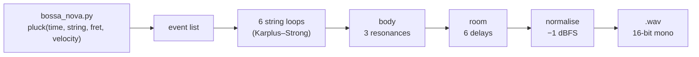
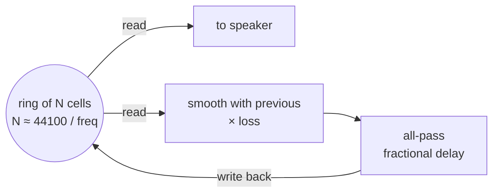

# music-as-code

A nylon-string acoustic guitar built from arithmetic, playing a bossa nova jam. Python standard library only: no samples, no audio libraries.

```bash
python3 bossa_nova.py   # writes bossa_nova.wav (24.2 s, renders in ~1.5 s)
```

| File | Role |
|---|---|
| [`acoustic_guitar.py`](acoustic_guitar.py) | The instrument: strings, body, room |
| [`bossa_nova.py`](bossa_nova.py) | The music: chords, rhythm, human feel |
| [`explainer/guitar-from-code.html`](explainer/guitar-from-code.html) | 21-page illustrated explainer (open in a browser) |
| [`examples/baitikochi-chuste/`](examples/baitikochi-chuste/) | Example: a film melody transcribed from a played performance, with slides |

---

## How code became an acoustic guitar



### 1 · Sound is a list of numbers

A `.wav` stores the speaker's position **44,100 times a second**, each value between −1 and +1.

| What you hear | What the numbers do |
|---|---|
| Pitch | how often the pattern repeats (A string: every 9.1 ms = 110 Hz) |
| Loudness | how far the numbers swing |
| Tone | the shape of the wiggle inside each repeat |

### 2 · Frets set the pitch

`freq = OPEN_STRINGS[string] * 2 ** (fret / 12)`: each fret is ×2^(1/12), so fret 12 doubles the pitch.

| String | E | A | D | G | B | e |
|---|---|---|---|---|---|---|
| Open (Hz) | 82.41 | 110.00 | 146.83 | 196.00 | 246.94 | 329.63 |

### 3 · A string is a loop of numbers (Karplus–Strong)



- **Ring length = pitch.** The A string needs 400.91 samples per trip: 400 whole cells, plus 0.5 from the smoothing and 0.41 from the all-pass.
- **Smoothing** averages each number with its neighbour, so high overtones fade faster than low ones. That's the nylon "bright attack, warm tail".
- **Loss per trip** is `0.001 ** (1 / (freq * ring_time))`: 0.984 for the A string, reaching −60 dB after 441 trips (4.0 s).
- **All-pass** fixes the leftover fraction. Without it, high e at fret 12 would be **+10.2 cents** sharp.

### 4 · The pluck is shaped noise

| Step | Code | Effect |
|---|---|---|
| 1. Random noise | `rng.uniform(-1, 1)` | every frequency at once |
| 2. Smoothed twice | `bright = 0.22 + 0.5 * velocity` | soft fingertip; harder plucks are brighter |
| 3. Minus a shifted copy | `noise[i] - 0.9 * noise[i - 0.2n]` | plucked 1/5 along the string |

Measured from one dry note, harmonics **5 and 10 sit ~30 dB below** their neighbours. That's the pluck point's fingerprint, just like a real string.

Measured harmonic decay (A string, 0.05 s → 2.5 s): fundamental **−37 dB**, 10th harmonic **−44 dB**.

### 5 · Ring time depends on pitch

`ring_time = 4.5 × (82.41 / freq) ** 0.4`

| String | E | A | D | G | B | e |
|---|---|---|---|---|---|---|
| Ring time (s) | 4.50 | 4.01 | 3.57 | 3.18 | 2.90 | 2.58 |

A new event on the same string ends the old note with a short fade: **8 ms** for a fresh pluck, **35 ms** for a resting finger (`mute`), so the cut never clicks.

### 6 · The wooden box

| Part | Model | Values |
|---|---|---|
| Body | 3 band-pass resonances added to the dry strings | 105 Hz air ×0.9 · 210 Hz top ×0.7 · 400 Hz ×0.4 |
| Room | 4 feedback delays → 2 all-passes, mixed in at 3% | 29.7 / 37.1 / 41.1 / 43.7 ms, feedback 0.78–0.72; blur 5 and 1.7 ms |

### 7 · Playing it: the bossa feel

132 bpm on an eighth-note grid (one eighth = 0.227 s).

```
count     1 & 2 & 3 & 4 & | 1 & 2 & 3 & 4 &
thumb     X . . . X . . . | X . . . X . . .
fingers   X . . X . . X . | . . X . . X . .
              bar A       |      bar B
```

- **Chords** are lists of `(string, fret)`: two thumb notes (root, fifth) plus 3–4 finger notes.
- **Progression:** Dm9 · G13 · Cmaj9 · A7b9 · Dm9 · G13 · Em7 · A7b9 · Dm9 · G13 · Cmaj9 → slow roll up C6/9.
- **Human feel** (seeded, so every run is identical): timing ±6 ms, finger notes 4 ms apart, thumb velocity 0.85±0.06, finger velocity 0.62/0.70±0.07 (on/off beat).

### 8 · Real guitar vs the code

| Real guitar | In the code |
|---|---|
| vibrating nylon | ring of numbers |
| string length and tension | ring length |
| fingertip | smoothed noise − shifted copy |
| air, wood, friction losses | averaging + × loss per trip |
| wooden body | 3 band-pass filters |
| room reflections | 4 delays + 2 all-passes |
| hands | event list + small randomness |

### Limits and next steps

| Limit | Possible fix |
|---|---|
| Strings never interact | feed a little of each string into the others |
| Mono | pan strings, stereo reverb |
| No finger noise | short noise bursts on shifts and slides |
| Same body for every note | convolve with a recorded impulse response |

---

String model: Karplus & Strong, "Digital Synthesis of Plucked-String and Drum Timbres" (1983). All numbers above were measured from this code.
